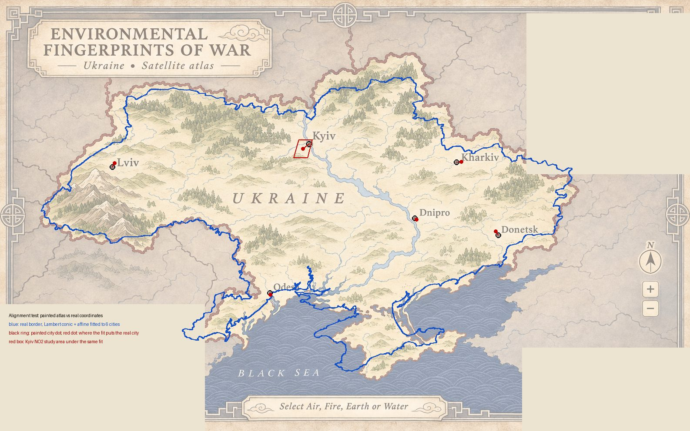
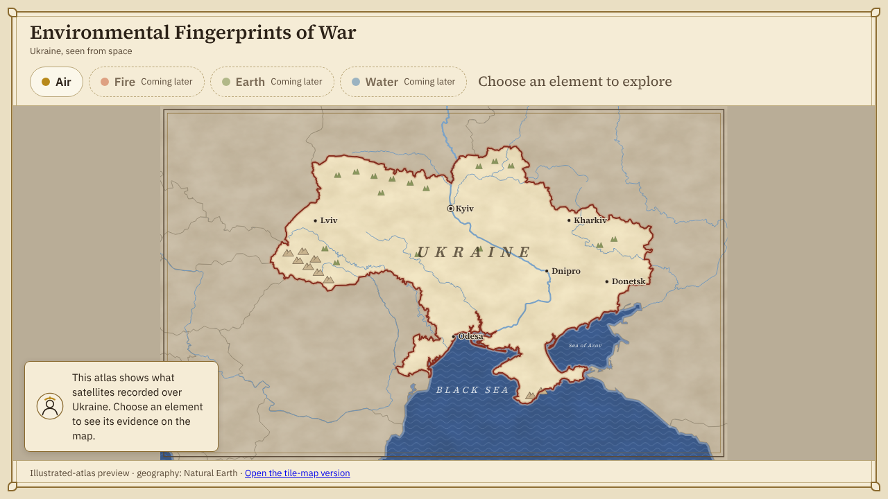
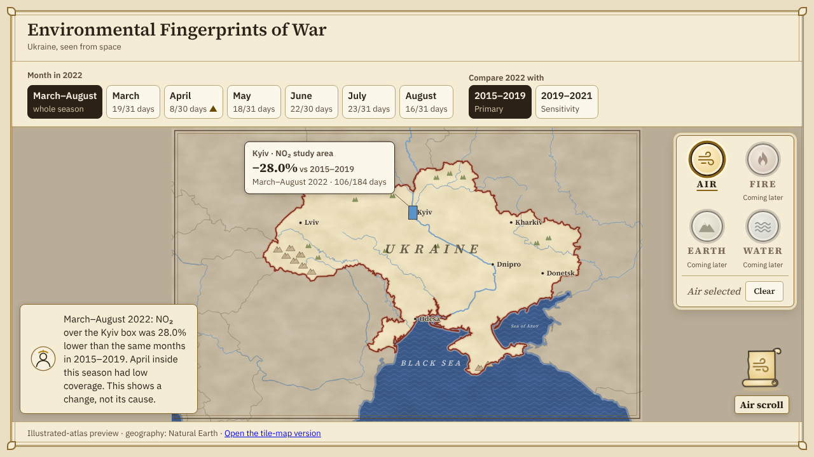
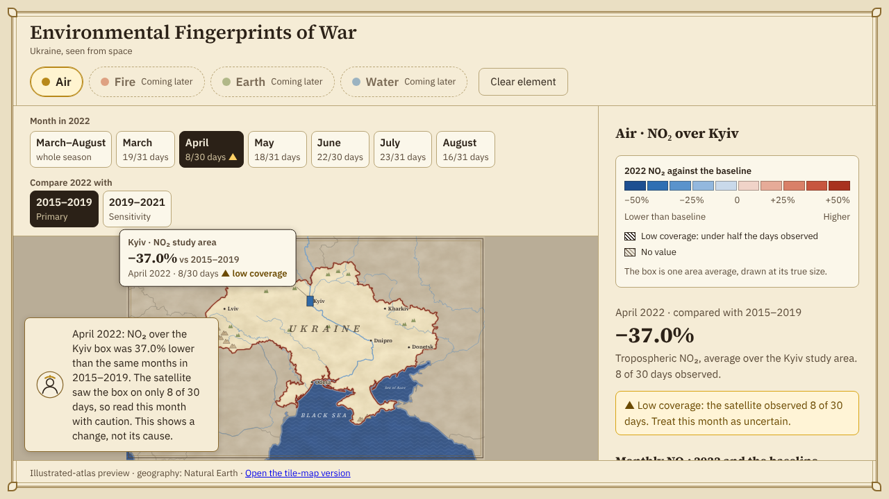
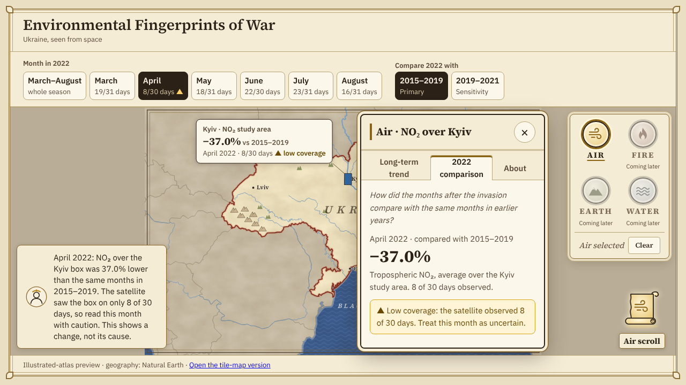
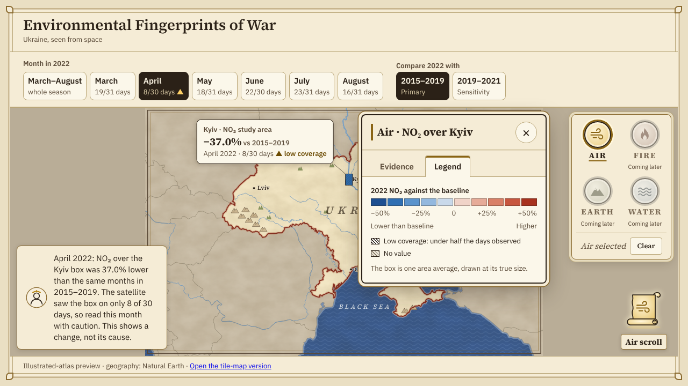
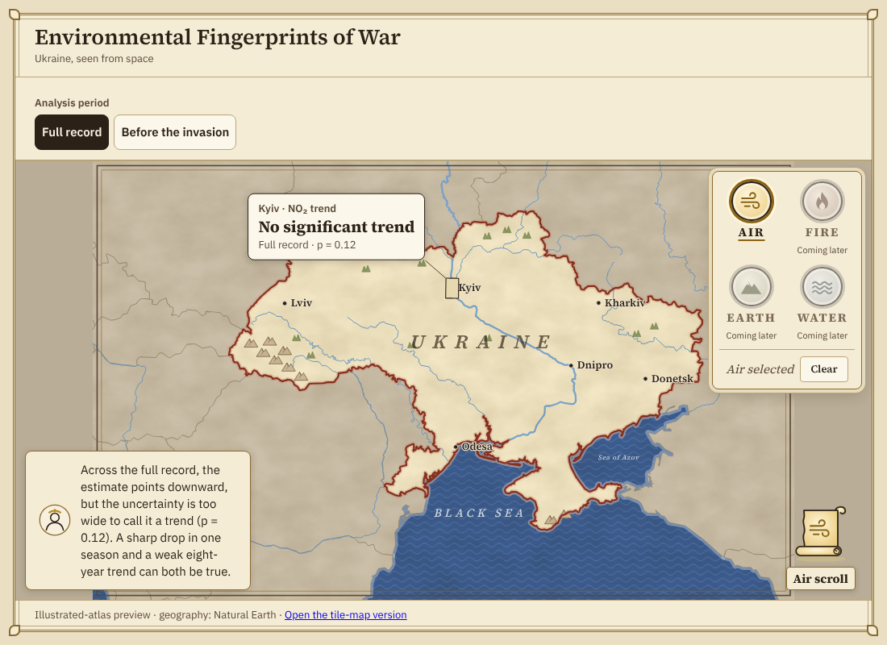
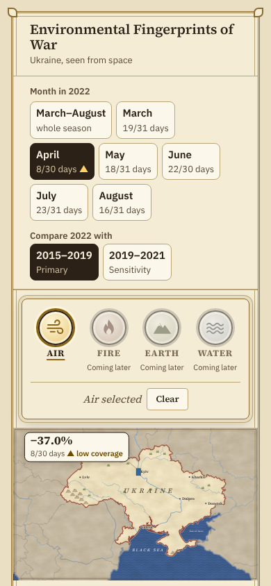

# Illustrated atlas: proof of concept

Preview route: **`/#/atlas`**. The tile-map explorer at `/` is unchanged.

Question tested: *can a painted map of Ukraine carry real evidence convincingly and accurately?*
Short answer: **not the generated painting itself, but an atlas drawn from real geography in the same style can.** This PoC ships the second.

## 1. Alignment test of the generated artwork

Script: `frontend/scripts/atlas/align_artwork.py` (artwork is passed as an argument and is not committed).
Raw numbers: `docs/screenshots/atlas-poc/alignment-report.json`.

Method

1. Located the six painted city dots (Kyiv, Lviv, Kharkiv, Dnipro, Donetsk, Odesa) by the centre of each dark dot, to about half a pixel.
2. Fitted longitude/latitude → pixel transforms in three projections (equirectangular, Mercator, Lambert conic), each as a similarity and as a full affine.
3. **Independent check A, held-out cities:** every way of fitting on four cities and predicting the other two (15 splits).
4. **Independent check B, painted border:** extracted the painted red border and measured how far it lies from Natural Earth's real border under each fit.
5. **Best case for the painting:** fitted an affine directly to the painted border, then checked the cities.

The Kyiv study box is 0.5° × 0.5°, which is about **32 × 44 px** on the 1586 × 992 artwork (1 px ≈ 1.2 km).

| Affine fit | Held-out city error, median | Held-out, worst | Median as share of box width | Painted border off by, median / 90% / worst |
|---|---|---|---|---|
| Equirectangular | 28 px (32 km) | 90 px (104 km) | 0.84 | 11 / 30 / 73 px |
| Mercator | 27 px (31 km) | 91 px (103 km) | 0.82 | 9 / 26 / 63 px |
| Lambert conic | 26 px (30 km) | 56 px (67 km) | 0.79 | 15 / 37 / 84 px |

- Even when all six cities are used for the fit, Kyiv itself is left 10–18 px off, a third to a half of the box width.
- Fitting the border instead puts the cities 14–96 px (16–109 km) away from their painted dots. The painting's border and its city dots disagree with each other, so no single smooth transform satisfies both.
- Visible in the figure: the painted Odesa sits about 100 km west of the real coast position, Crimea and the Azov coast have a different shape, and the Kyiv box comes out sheared.



**Verdict: unsuitable.** An expected error of about 0.8 box widths means the Kyiv rectangle could not be placed from coordinates; it would have to be placed by eye, and Fire points would land in the wrong districts. A rubber-sheet warp through the six cities would hide the error at those six points only and cannot be validated anywhere else.

## 2. What the PoC uses instead

A geographically accurate atlas in the illustrated style:

- **Geography:** Natural Earth 1:10m (public domain), Ukraine point-of-view file, so Crimea is drawn as part of Ukraine. Rebuilt by `frontend/scripts/atlas/build_geo.py` into `frontend/src/features/atlas/geo/atlas-geo.json`.
- **Coordinate mapping (one, shared):** `frontend/src/features/atlas/projection.ts`. Lambert conformal conic (`d3-geo` `geoConicConformal`), standard parallels 46°N and 51°N, central meridian 31.5°E, fitted once to the fixed box 22.0–40.35°E, 44.2–52.5°N inside a 1600 × 1000 viewBox. Every layer calls `projectLonLat`; nothing is positioned by hand.
- **Style:** parchment, inked border, wave-patterned sea, mountain and forest glyphs placed at the real Carpathians, Crimean Mountains and northern forests. Interface controls are HTML, separate from the map drawing.
- **Fixed camera:** no pan, no zoom. Selecting an element or a month never moves the map.
- **Resizing:** base map and overlays share one SVG viewBox; the HTML label is positioned in percentages of the same frame.

Checks

- `projection.test.ts`: round-trips the cities, and matches an independently written Lambert conformal conic (Snyder) to a thousandth of an atlas unit; the API's Kyiv box is centred on Kyiv with the right width-to-height ratio.
- `e2e/atlas.spec.ts` (real backend): at 1440, 1100, 820 and 390 px wide the polygon's centre is within 1 px of where the projection puts Kyiv, and polygon and label keep the same position as a fraction of the frame.

## 3. Interaction

| Corner | What it does |
|---|---|
| Top right: **element medallions** | Air, Fire, Earth, Water (generic glyphs: wind, flame, mountain, waves). Availability comes from the catalog; “Coming later” ones are disabled. Pressing the selected one again, or **Clear**, returns to neutral. The status line reads “No element selected” or “Air selected”. |
| Above the map: **time and comparison bar** | Appears for layers that support it. Its row is reserved from the start, so choosing an element never resizes the map. |
| Bottom left: **guide** | One or two sentences for the current month, baseline and feature. |
| Bottom right: **element scroll** | Takes on the selected element's colour and glyph, and beckons once when an element is first chosen. Clicking it opens the scroll **over the map**, with an **Evidence** tab (reading, chart, coverage, source) and a **Legend** tab (colour key). With no element selected it explains how to read the atlas. Escape or × closes it and returns focus to the scroll. |

On wide screens the opened scroll is sized to stay right of the layer's focus feature (`data-atlas-focus`, the Kyiv polygon for Air), so the box and its label stay visible; at 1280 px it sits 16 px clear of the box. Below 1,100 px it may overlap, rather than shrink under 16rem. On phones it opens as a bottom sheet.

## 4. Structure: one fixed atlas, interchangeable evidence layers

```
features/atlas/
  AtlasPage.tsx         shell: active element, scroll open/closed, layout. LayerHost: shared selection + data loading
  ElementMedallions.tsx top-right element chooser
  EvidenceScroll.tsx    bottom-right scroll button and the over-map scroll with tabs
  elementArt.tsx        element glyphs, scroll drawing and element colours
  AtlasBase.tsx         the fixed base map
  projection.ts         the single coordinate mapping
  LayerControlsBar.tsx  generic time / comparison controls
  layers/
    types.ts            EvidenceLayer contract
    registry.ts         element id → layer
    air/                Air adapter, map marks, key, evidence body
```

The shell owns the selection: active element, `period`, `comparison`, `feature`. A layer turns its data plus that selection into four outputs (`LayerPresentation`):

| Output | Field | Air |
|---|---|---|
| Map layer | `mapSvg`, `mapHtml` | Kyiv study polygon from `map.study_boundary`, filled by percent change; anchored label that is also the selection button |
| Controls | `controls` | whole season + six months; two baselines. Groups a layer omits are not rendered |
| Evidence scroll | `evidence`, `mapKey` | Evidence tab: selected reading, monthly NO₂ chart, coverage warnings, notices, source. Legend tab: fixed key |
| Guide | `guide` | one or two sentences for the selected month, baseline and feature |

Air reuses the existing API client, `adapters/baselines`, `adapters/months`, `adapters/format`, `ComparisonChart`, `CoverageWarnings`, `ElementControls`, `GuideBubble`, `TitleBadge` and `DecorativeFrame`. No new calculations: every number is read from `/api/air/kyiv`. Missing comparisons stay missing (a "no value" pattern and words, never zero).

Colour: a fixed diverging scale, −50% to +50% in ten steps, blue for lower than baseline and red for higher. It does not rescale with the selection. April 2015–2019 (−37.0%) and April 2019–2021 (−33.2%) fall in the same step, so the number carries the difference.

### Adding Fire

1. Backend: expose the detections (or per-cell monthly counts) and list the study endpoint under the `fire` element in `/api/cases`.
2. Write `layers/fire/fireLayer.tsx` implementing `EvidenceLayer`:
   - `load`: fetch the study.
   - `present`: 
     - `controls.periods`: the months and years it supports; `controls.comparisons`: display modes such as "detections", "cells", "change vs 2019–2021".
     - `mapSvg`: `<circle>` per detection or `<path>` per cell, positions from `projectLonLat` / `ringPath`. Above a few thousand points, draw to a `<canvas>` returned in `mapHtml`, sized to the frame, using the same `projectLonLat`.
     - `mapKey`, `evidence`, `guide`: its own key, regional comparison, detection limits (counts are not unique fires or burned area).
3. Add `fire: fireLayer` to `layers/registry.ts`.

No change to the shell, the base map, the controls bar or the layout.

## 5. Running it

```bash
uvicorn backend.main:app --port 8000        # repo root
cd frontend && npm ci && npm run dev         # http://127.0.0.1:5173/#/atlas
npm test                                     # 49 unit tests
npm run test:e2e                             # 22 browser tests against the real backend
```

## 6. Screenshots

| | |
|---|---|
| Neutral |  |
| Air, March–August |  |
| Air, April |  |
| Air scroll open, Evidence |  |
| Air scroll open, Legend |  |
| 1100 px wide |  |
| Mobile |  |

## 7. Limits and open points

- The style is drawn in SVG and is plainer than the generated painting. A commissioned or regenerated painting could replace `AtlasBase` only if it is drawn over this projection's outline, then re-tested with `align_artwork.py`.
- The guide uses the existing placeholder mark. The mockup's guide is a character from an existing franchise and is not used here.
- At phone width the map is small; the label shrinks to the value and coverage, and the full reading sits in the evidence widget below.
- The element glyphs are generic drawings. The franchise nation emblems from the reference images are not used.
- `main` was checked: its newer commits do not touch `frontend/`, `backend/` or the Air API, so nothing was merged into this branch.
